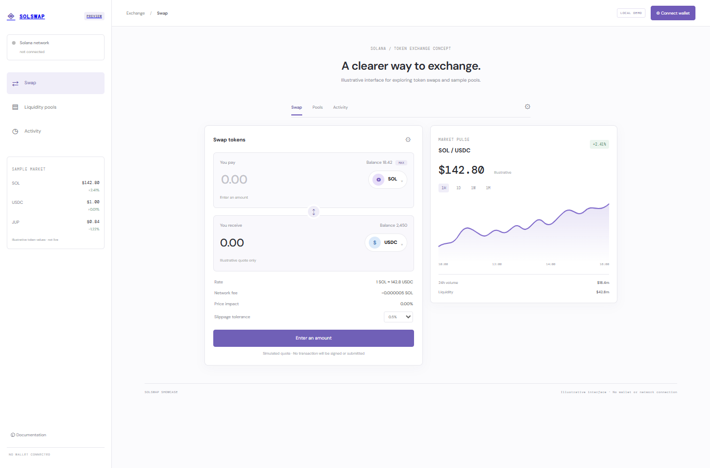

# SolSwap

A decentralized exchange interface concept with illustrative token quotes, a sample market chart, and pool directory. Token names, prices, balances, pool depth, and returns are all demo data.

## Run locally

From the workspace root, run `npm install`, then `npm run dev --workspace=solswap-dex` and open `http://localhost:3011`. For production, run `npm run build --workspace=solswap-dex` and `npm run start --workspace=solswap-dex`.

## Features

- Select token pairs, calculate an illustrative fee-adjusted quote, and change slippage display.
- Browse sample pools, favorite pairs, and inspect sample activity state.
- Responsive exchange layout and sample market chart.
- Anchor source in `programs/solswap` includes canonical pool initialization, proportional liquidity positions, fee-adjusted constant-product swaps with a caller-set minimum output, and liquidity withdrawal.

## Scope and wallet boundary

The browser demo has no wallet adapter or RPC connection and does not call the Anchor source. The program uses SPL token vaults controlled by a pool PDA, a constant-product formula with a fixed 30 bps fee, and recorded liquidity positions. It has no oracle, routed trade, LP token, or production audit. Quotes in the browser use static sample prices and must not be used to make trading decisions. The program is not deployed, and its configured ID is a development identifier without a generated deployment keypair.

## Anchor source

The Anchor workspace is pinned to 1.2.2 and targets localnet by default. With Rust, Solana/Agave tools, and Anchor 1.2.2 installed, run `cargo fmt --all`, `cargo test --workspace`, `cargo check --workspace`, and `anchor build --ignore-keys` from this directory. Anchor may create an ignored local build keypair under `target/`; it is not synced with the source ID and is not a deployment key. Before any Devnet deployment, generate an intentional program keypair, sync the program ID, and update the Anchor configuration to `Devnet`. This source has not been security-audited; do not use it with valuable assets. No deploy keypair, deployment, or Devnet transaction is included in this demo.

`cargo test --workspace` runs pool math tests and a local `solana-program-test` flow that adds liquidity, swaps tokens, and withdraws the position using the SPL Token processor. Deterministic mint, pool, user token, and vault account states are loaded locally; the test checks pool reserves and token balances throughout and uses no external cluster.

## Tech stack badges

   

## Screenshots

## Environment variables

No environment variables are required. This showcase uses local sample data and runs without paid APIs or external credentials.
